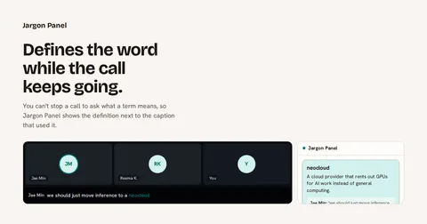

<picture>
  <source media="(prefers-color-scheme: dark)" srcset="assets/banner-dark.svg">
  
</picture>

# Eric Zou

20, 2nd year Electrical Engineering at Waterloo. 

The most ambitious problem I'm solving: I'm building interoceptive AI. It's my bet for AGI.

External context, like email connectors, wallet connectors or world models, only captures humans' stated preferences, which is an act we all put on. Revealed preferences are how we actually think, feel and make decisions, and I think AGI has to start there, by pulling context from within.

## Ongoing

<table>
<tr>
<td></td>
<td><a href="https://github.com/EricJujianZou/rederive"><b>rederive</b></a> let's you rederive any codebase from first principles. It works on your own repo or on a famous one like Express or Redis.</td>
</tr>
<tr>
<td></td>
<td><a href="https://github.com/EricJujianZou/llm-dream"><b>llm-dream</b></a> asks whether an LLM can dream. I corrupted part of an agent's daily conversation log before it rewrote its memory each night, to test whether distorted replay helps it generalize the way the overfitted brain hypothesis says dreams do. It did not help in any of 30 runs. I submitted the paper to arXiv on October 14, 2026, and the write-up is on <a href="https://waterlooagi.com/experiments/llm-dream/">waterlooagi.com</a>.</td>
</tr>
<tr>
<td></td>
<td><a href="https://watnow.ugmi.ca"><b>watnow</b></a> reads every course on Learn and answers "what's due this week?" Over 2,000 Waterloo students installed it.</td>
</tr>
</table>

## Past

<table>
<tr>
<td></td>
<td><a href="https://watsworthit.ugmi.ca"><b>WatsWorthIt</b></a> adds pay per hour and an ROI score to the WaterlooWorks job table. Over 200 people installed it.</td>
</tr>
<tr>
<td></td>
<td><a href="https://ericzou.dev/jargon/"><b>Jargon Panel</b></a> defined jargon in a Chrome side panel next to the Google Meet caption that used it. I put up a waitlist to see who wanted it, and the page is still there.</td>
</tr>
<tr>
<td></td>
<td><a href="https://antisoy.com"><b>Anti-Soy</b></a> helped non-technical recruiters judge candidates from their GitHub code.</td>
</tr>
</table>

## How I work

Agents pick up tickets on my own harness and open PRs, and I review them. The [skills](https://github.com/EricJujianZou/skills) I run in Claude Code are public. rederive is the one I'd start with:

```
/plugin marketplace add EricJujianZou/rederive
/plugin install rederive@rederive
```

The rest, including humanizer and brainrotifier, come from the skills repo:

```
/plugin marketplace add EricJujianZou/skills
/plugin install ez-skills@ez
```

## Talk to me

I'm learning design and distribution right now, and I want to talk to people who do design, product or marketing for a living. [Book 20 minutes](https://calendly.com/ericzou/chat) or email e2zou@uwaterloo.ca.

Writing at [ericzou.dev](https://ericzou.dev). [Resume](https://ericzou.dev/assets/Eric_Zou_Resume_FDE_2027.pdf).
