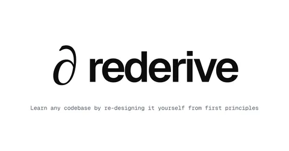
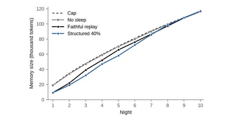
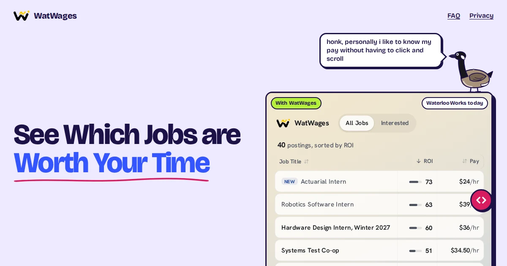
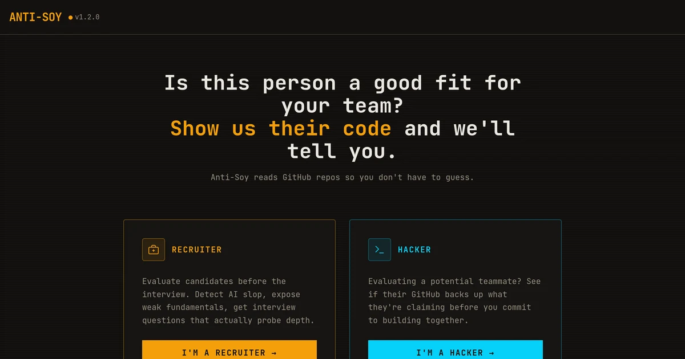

<picture>
  <source media="(prefers-color-scheme: dark)" srcset="assets/banner-dark.svg">
  
</picture>

# Eric Zou

20, 2nd year Electrical Engineering at Waterloo. 

The most ambitious problem I'm solving: I'm building the extraction layer of latent variables for AGI infrastructure.

External context, like email connectors, wallet connectors or world models, only captures humans' stated preferences, which is an act we all put on. Revealed preferences are how we actually think, feel and make decisions, and I think AGI has to start there, by pulling context from within.

## Projects

<table>
<tr>
<td width="30%"></td>
<td width="45%"><h3><a href="https://github.com/EricJujianZou/rederive">rederive</a></h3>Lets you rederive any codebase from first principles. It works on your own repo or on a famous one like Express or Redis.</td>
<td width="25%"><b>200 stars in 7 days</b></td>
</tr>
<tr>
<td></td>
<td><h3><a href="https://github.com/EricJujianZou/llm-dream">llm-dream</a></h3>Asks whether an LLM can dream. I corrupted part of an agent's daily conversation log before it rewrote its memory each night, to test whether distorted replay helps it generalize the way the overfitted brain hypothesis says dreams do. It did not help in any of 30 runs.</td>
<td><b>Submitted to arXiv</b>  <b>Write-up on <a href="https://waterlooagi.com/experiments/llm-dream/">waterlooagi.com</a></b></td>
</tr>
<tr>
<td></td>
<td><h3><a href="https://watnow.ugmi.ca">watnow</a></h3>Reads every course on Learn and answers "what's due this week?" The 1st student initiative to be officially endorsed by UWaterloo in 65 years.</td>
<td><b>2,200 installs</b>  <b>1,200 weekly active users</b>  <b>42% week 4 retention</b></td>
</tr>
<tr>
<td></td>
<td><h3><a href="https://watwages.ugmi.ca">WatsWorthIt</a></h3>Adds pay per hour and an ROI score to the WaterlooWorks job table.</td>
<td><b>400 installs</b></td>
</tr>
<tr>
<td></td>
<td><h3><a href="https://antisoy.com">Anti-Soy</a></h3>Helped non-technical recruiters judge candidates from their GitHub code.</td>
<td></td>
</tr>
</table>

## Talk to me

I'm learning design and distribution right now, and I want to talk to people who do design, product or marketing for a living. [Book 20 minutes](https://calendly.com/ericzou/chat) or email e2zou@uwaterloo.ca.

Writing at [ericzou.dev](https://ericzou.dev). [Resume](https://ericzou.dev/assets/Eric_Zou_Resume_FDE_2027.pdf).
